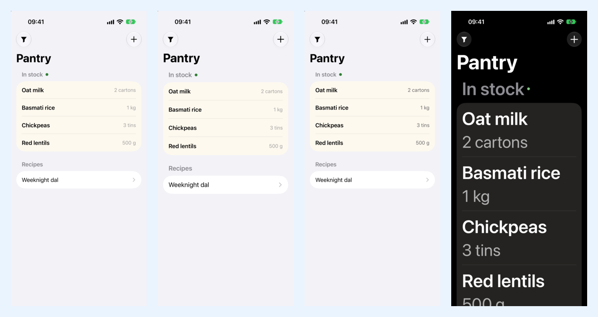

<!-- i18n-source: README.md@9b89a12078d421a75c4e78c0de2f0c9deba28fd2 status=reviewed -->
<!-- brand:start -->

<p align="center"><picture><source media="(prefers-color-scheme: dark)" srcset="https://raw.githubusercontent.com/muhittincamdali/a11ylabel/main/.github/brand/banner-dark.svg"><source media="(prefers-color-scheme: light)" srcset="https://raw.githubusercontent.com/muhittincamdali/a11ylabel/main/.github/brand/banner-light.svg"></picture></p>

<!-- lang-selector:start -->
<p align="center"><a href="README.md">English</a> · <a href="README.tr.md">Türkçe</a> · <a href="README.zh-CN.md">简体中文</a> · <a href="README.ja.md">日本語</a> · <a href="README.ko.md">한국어</a> · <a href="README.es.md">Español</a> · <a href="README.de.md">Deutsch</a> · <a href="README.fr.md">Français</a> · <a href="README.pt-BR.md">Português (Brasil)</a> · <a href="README.ru.md">Русский</a></p>
<!-- lang-selector:end -->

<p align="center">
<a href="https://github.com/muhittincamdali/a11ylabel/actions/workflows/ci.yml"></a>
<a href="https://github.com/muhittincamdali/a11ylabel/releases"><picture><source media="(prefers-color-scheme: dark)" srcset="https://raw.githubusercontent.com/muhittincamdali/a11ylabel/main/.github/brand/badge-version-dark.svg"><source media="(prefers-color-scheme: light)" srcset="https://raw.githubusercontent.com/muhittincamdali/a11ylabel/main/.github/brand/badge-version-light.svg"></picture></a>
<a href="https://github.com/muhittincamdali/a11ylabel/blob/main/package.json"><picture><source media="(prefers-color-scheme: dark)" srcset="https://raw.githubusercontent.com/muhittincamdali/a11ylabel/main/.github/brand/badge-language-dark.svg"><source media="(prefers-color-scheme: light)" srcset="https://raw.githubusercontent.com/muhittincamdali/a11ylabel/main/.github/brand/badge-language-light.svg"></picture></a>
<a href="https://github.com/muhittincamdali/a11ylabel/blob/main/LICENSE"><picture><source media="(prefers-color-scheme: dark)" srcset="https://raw.githubusercontent.com/muhittincamdali/a11ylabel/main/.github/brand/badge-license-dark.svg"><source media="(prefers-color-scheme: light)" srcset="https://raw.githubusercontent.com/muhittincamdali/a11ylabel/main/.github/brand/badge-license-light.svg"></picture></a>
</p>

<p align="center">
<a href="#démarrage-rapide"><picture><source media="(prefers-color-scheme: dark)" srcset="https://raw.githubusercontent.com/muhittincamdali/a11ylabel/main/.github/brand/button-start-fr-dark.svg"><source media="(prefers-color-scheme: light)" srcset="https://raw.githubusercontent.com/muhittincamdali/a11ylabel/main/.github/brand/button-start-fr-light.svg"></picture></a>
<a href="https://muhittincamdali.github.io/a11ylabel/"><picture><source media="(prefers-color-scheme: dark)" srcset="https://raw.githubusercontent.com/muhittincamdali/a11ylabel/main/.github/brand/button-docs-fr-dark.svg"><source media="(prefers-color-scheme: light)" srcset="https://raw.githubusercontent.com/muhittincamdali/a11ylabel/main/.github/brand/button-docs-fr-light.svg"></picture></a>
<a href="https://github.com/muhittincamdali/a11ylabel/tree/main/docs/guides"><picture><source media="(prefers-color-scheme: dark)" srcset="https://raw.githubusercontent.com/muhittincamdali/a11ylabel/main/.github/brand/button-guides-fr-dark.svg"><source media="(prefers-color-scheme: light)" srcset="https://raw.githubusercontent.com/muhittincamdali/a11ylabel/main/.github/brand/button-guides-fr-light.svg"></picture></a>
<a href="https://github.com/muhittincamdali/a11ylabel/tree/main/examples"><picture><source media="(prefers-color-scheme: dark)" srcset="https://raw.githubusercontent.com/muhittincamdali/a11ylabel/main/.github/brand/button-examples-fr-dark.svg"><source media="(prefers-color-scheme: light)" srcset="https://raw.githubusercontent.com/muhittincamdali/a11ylabel/main/.github/brand/button-examples-fr-light.svg"></picture></a>
</p>

> Ceci est une traduction du README anglais. En cas de différence, la version anglaise fait foi.

<!-- brand:end -->

App Store Connect demande à chaque app lesquelles des neuf Accessibility Nutrition Labels elle prend en charge : c’est facultatif
aujourd’hui, et Apple indique que ce sera obligatoire pour les nouvelles apps et les mises à jour (aucune date n’avait été
donnée le 28 octobre 2026). a11ylabel lit un projet iOS natif, Flutter ou React Native/Expo et montre, pour chaque
étiquette, si quelque chose dans le code la bloque déjà, ce qu’il faut vérifier et ce que seule une personne peut contrôler,
avec la correction de chaque constat et la page d’Apple sur laquelle il s’appuie. Il lit les fichiers de votre projet ; il ne
compile, n’exécute et ne modifie rien.

<picture><source media="(prefers-color-scheme: dark)" srcset="docs/media/demo-summary-dark.svg"><source media="(prefers-color-scheme: light)" srcset="docs/media/demo-summary-light.svg"></picture>

<sub>Enregistré avec la vraie CLI sur le
<a href="fixtures/native-swiftui-blocked">fixture native-swiftui-blocked</a>, une app SwiftUI écrite pour les
tests (<code>npm run demo</code>).</sub>

## Points forts

- **Un tableau pour les neuf étiquettes.** VoiceOver, Voice Control, Larger Text, Dark Interface,
  Differentiate Without Color Alone, Sufficient Contrast, Reduced Motion, Captions et Audio
  Descriptions, chacune **blocked**, **review**, **no blocker found** ou **check by hand**, avec un lien vers les
  critères d’évaluation d’Apple.
- **Trouve ce qui bloque une étiquette pour toute l’app.** `UIUserInterfaceStyle` Light dans un Info.plist,
  un build setting ou une configuration Expo (Expo utilise le mode clair quand la clé est absente) ; une mise à
  l’échelle du texte verrouillée dans `Text.defaultProps`, un `MaterialApp.builder` de Flutter, une scene SwiftUI
  ou une window UIKit.
- **Et les endroits à vérifier.** Du texte qui ne s’adapte pas ou s’arrête sous 200 %, des tailles de police fixes,
  des boutons avec icône seule et sans étiquette, des animations sans fin, avec parallaxe ou lancées
  automatiquement dans du code qui ne lit jamais Reduce Motion, et la vérification Flutter que iOS ne renseigne jamais.
- **Connaît les plateformes.** React Native 0.78 et les versions suivantes ignorent `Text.defaultProps` (React 19),
  donc a11ylabel ne le signale pas ; le `disableAnimations` de Flutter ne suit pas Reduce Motion d’iOS ;
  Reanimated le suit par défaut.
- **Chaque règle a une source.** Les règles sont des données ([rules/nutrition-labels.json](rules/nutrition-labels.json))
  qui citent les pages d’Apple, de React Native, d’Expo, de Flutter et de Reanimated ; les tests échouent si une
  règle n’en a aucune.
- **Vérifié dans le Simulator.** À la plus grande taille de texte en Dark Mode sur iOS 27.0, le fixture blocked
  reste clair avec un texte plafonné, et le fixture corrigé passe en sombre avec un texte en AX5.
- **Conçu pour la CI.** `--labels` ne vérifie que les étiquettes que vous revendiquez ; rapports dans le terminal, en
  texte brut, en Markdown et en JSON ; code de sortie 0 si tout est propre, 1 s’il y a des constats, 2 en cas d’erreur d’usage.

## Démarrage rapide

**1. Installez a11ylabel.** Avec [Homebrew](https://brew.sh/), qui installe aussi Node.js :

```sh
brew install muhittincamdali/tap/a11ylabel
```

Ou avec npm depuis la [GitHub release](https://github.com/muhittincamdali/a11ylabel/releases/tag/v0.1.0), ce qui
nécessite [Node.js](https://nodejs.org/) 22.12 ou une version ultérieure (`node --version` l’affiche) :

```sh
npm i -g https://github.com/muhittincamdali/a11ylabel/releases/download/v0.1.0/a11ylabel-0.1.0.tgz
```

Le paquet n’est pas encore sur le registre npm ; sa publication là-bas sous le nom `@mcamdali/a11ylabel` est
prévue. Les deux commandes installent le même tarball de la release.

**2. Ouvrez un terminal dans le dossier de votre app**, celui qui contient le `.xcodeproj`, `pubspec.yaml` ou
`package.json` :

```sh
cd path/to/YourApp
```

**3. Lancez a11ylabel :**

```sh
a11ylabel
```

**4. Lisez le tableau en haut.** Une étiquette **blocked** a une error qui la bloque pour toute l’app :
corrigez-la en premier. **review** liste les endroits qui peuvent empêcher une tâche courante ; examinez chacun
avec la fonction activée. Les étiquettes **check by hand** dépendent d’un design ou de médias que le code ne montre
pas. Chaque constat indique sa correction dans la liste « How to fix », et
[Before you claim a label](docs/guides/claiming-labels.md) détaille le reste.

## Ce que vérifie a11ylabel

La [présentation](https://developer.apple.com/help/app-store-connect/manage-app-accessibility/overview-of-accessibility-nutrition-labels)
d’Apple demande que les personnes puissent accomplir toutes les tâches courantes d’une app avec une fonction
activée avant que l’app revendique l’étiquette. Le code peut montrer une partie de ce qui les en empêche :

| Étiquette                         | Dans le code | Ce que cherche a11ylabel                                                                                                                              |
| --------------------------------- | ------------ | ----------------------------------------------------------------------------------------------------------------------------------------------------- |
| VoiceOver                         | en partie    | Boutons avec icône seule et sans étiquette ; étiquettes qui nomment le type de contrôle                                                               |
| Voice Control                     | en partie    | Boutons avec icône seule et sans nom à afficher et à dire                                                                                             |
| Larger Text                       | oui          | Mise à l’échelle désactivée ou plafonnée sous 200 %, pour l’app ou pour une vue ; tailles de police fixes                                             |
| Dark Interface                    | oui          | Une apparence claire forcée dans Info.plist, les build settings, la config Expo ou le code ; pas de `darkTheme` Flutter ; couleurs sans valeur sombre |
| Differentiate Without Color Alone | non          | Rien : c’est une question de design                                                                                                                   |
| Sufficient Contrast               | un indice    | Couleurs d’asset sans valeur de contraste élevé                                                                                                       |
| Reduced Motion                    | oui          | Animations sans fin, rotatives, avec parallaxe ou lancées automatiquement là où Reduce Motion n’est pas lu                                            |
| Captions                          | un indice    | Si l’app lit de la vidéo                                                                                                                              |
| Audio Descriptions                | un indice    | Si l’app lit de la vidéo                                                                                                                              |

| Règle   | Severity | Constat                                                                                         | Code                            |
| ------- | -------- | ----------------------------------------------------------------------------------------------- | ------------------------------- |
| A11Y101 | error    | Taille du texte verrouillée pour toute l’app (sous 200 %)                                       | tous                            |
| A11Y102 | warning  | Un texte ou une vue qui ne s’adapte pas                                                         | tous                            |
| A11Y103 | warning  | Un texte ou une vue plafonné sous 200 %                                                         | tous                            |
| A11Y104 | warning  | Une taille en points fixe : `.system(size:)`, `Font.custom(_:fixedSize:)`, `UIFont(name:size:)` | SwiftUI, UIKit                  |
| A11Y201 | error    | Apparence claire forcée pour toute l’app, sans moyen de passer en sombre                        | Info.plist, build setting, Expo |
| A11Y202 | info     | Clair par défaut, sombre via un réglage dans l’app                                              | Info.plist, build setting, Expo |
| A11Y203 | warning  | Un jeu de couleurs clair défini dans le code                                                    | tous                            |
| A11Y204 | warning  | Un `MaterialApp` sans `darkTheme`                                                               | Flutter                         |
| A11Y205 | info     | Couleurs d’asset sans variante sombre                                                           | asset catalog                   |
| A11Y301 | warning  | Animation dans une app qui ne lit jamais Reduce Motion                                          | tous                            |
| A11Y302 | info     | Animation dans un fichier qui ne lit pas Reduce Motion                                          | tous                            |
| A11Y303 | warning  | Flutter lit `disableAnimations`, que Reduce Motion d’iOS ne renseigne pas                       | Flutter                         |
| A11Y304 | warning  | Une animation Reanimated réglée sur `ReduceMotion.Never`                                        | React Native, Expo              |
| A11Y401 | warning  | Bouton avec icône seule sans étiquette d’accessibilité                                          | tous                            |
| A11Y402 | info     | Étiquette d’accessibilité qui nomme le type de contrôle                                         | tous                            |
| A11Y501 | info     | Couleurs d’asset sans variante à contraste élevé                                                | asset catalog                   |
| A11Y601 | info     | L’app lit de la vidéo                                                                           | tous                            |

Données de règles `nutrition-labels@2026.10.28`, sources lues le 28 octobre 2026. Une error bloque une
étiquette ; un warning la met en « review » ; les constats info ne changent jamais l’état d’une étiquette.

## Ce que montre le Simulator

La même app SwiftUI avant et après les corrections, compilée avec Xcode 27.1 (SDK iOS 27.1) et lancée
sur un simulator d’iPhone 17 sous iOS 27.0, d’abord à la taille de texte par défaut en mode clair, puis à la plus
grande taille d’accessibilité (AX5) en Dark Mode
([comment](fixtures/README.md#what-the-simulator-shows)) :

<p align="center"></p>

| Fixture (iOS 27.0 Simulator) | Luminosité, par défaut → AX5 Dark Mode | Pixels modifiés | a11ylabel                             |
| ---------------------------- | -------------------------------------- | --------------- | ------------------------------------- |
| native-swiftui-blocked       | 0,97 → 0,97                            | 7 %             | Larger Text et Dark Interface blocked |
| native-swiftui-ready         | 0,97 → 0,57                            | 99 %            | aucun blocage                         |

La luminosité est la moyenne de la capture d’écran en niveaux de gris (0 noir, 1 blanc) au-dessus de l’indicateur
d’accueil ; les enregistrements sont dans [docs/media/simulator](docs/media/simulator). Le
[fixture Flutter](docs/media/simulator/flutter-tide-ax5-dark.png), avec les mêmes réglages, reste clair
(pas de `darkTheme`) avec un texte à 130 %.

## Installation

Les commandes du Démarrage rapide installent la commande `a11ylabel` depuis la GitHub release. Chaque
[GitHub release](https://github.com/muhittincamdali/a11ylabel/releases) fournit le paquet sous le nom
`a11ylabel-<version>.tgz` avec un fichier `SHA256SUMS`. Pour figer une release dans un projet :

```sh
npm install --save-dev https://github.com/muhittincamdali/a11ylabel/releases/download/v0.1.0/a11ylabel-0.1.0.tgz
```

`npx a11ylabel` exécute ensuite cette copie. Le paquet s’installe sous le nom `@mcamdali/a11ylabel`, le nom
qu’importe l’API JavaScript ci-dessous. La publication sur le registre npm est prévue ; d’ici là,
`npx @mcamdali/a11ylabel` ne trouve pas le paquet.

## Utilisation

```text
a11ylabel [path] [options]
```

| Option                  | Ce qu’elle fait                                                                    |
| ----------------------- | ---------------------------------------------------------------------------------- |
| `path`                  | Dossier du projet ou `.xcodeproj` ; par défaut, le dossier courant                 |
| `-f, --format <format>` | `tty` (par défaut), `text`, `markdown` ou `json`                                   |
| `--json`                | Identique à `--format json`                                                        |
| `-o, --output <file>`   | Écrit le rapport dans un fichier au lieu du terminal                               |
| `-l, --labels <ids>`    | Ne vérifie que ces étiquettes, séparées par des virgules (par défaut : les neuf)   |
| `-s, --summary`         | Seulement le tableau des étiquettes et le verdict (formats terminal et texte)      |
| `--fail-on <severity>`  | `warning` (par défaut), `error`, `info` ou `none` : quand le code de sortie vaut 1 |
| `--no-color`            | Texte brut même dans un terminal (`NO_COLOR` et `FORCE_COLOR` sont respectés)      |

Identifiants d’étiquettes : `voiceover`, `voice-control`, `larger-text`, `dark-interface`,
`differentiate-without-color`, `sufficient-contrast`, `reduced-motion`, `captions`,
`audio-descriptions`.

Codes de sortie : `0` rien au niveau de `--fail-on` ni au-dessus, `1` des constats à ce niveau ou au-dessus,
`2` arguments incorrects, aucun projet iOS trouvé ou erreur inattendue. Quand l’Info.plist ou le projet Xcode qui
détermine Dark Interface ne peut pas être lu, cette étiquette est « not known » et le code de sortie vaut aussi `1`,
sauf avec `--fail-on none`.

a11ylabel trouve l’app iOS tout seul : un `.xcodeproj` à la racine ou un dossier plus bas pour les apps natives,
`ios/` pour les apps Flutter, React Native et Expo (`example/ios/` pour un plugin Flutter). Il lit l’Info.plist
(XML ou binaire) et les build settings de chaque target d’app iOS, les jeux de couleurs de leurs asset catalogs, les
fichiers Swift et Objective-C de l’app, le JavaScript et le TypeScript d’une app React Native ou Expo et les fichiers
Dart de `lib/`, en ignorant les dépendances, les sorties de compilation et les tests. Une app Expo sans `ios/` est
vérifiée à partir de sa configuration.

### Ne vérifier que les étiquettes que vous revendiquez

```sh
a11ylabel --labels larger-text,dark-interface,reduced-motion
```

Le tableau, les constats et le code de sortie ne couvrent alors que ces étiquettes, si bien que la CI échoue quand un
changement casserait une étiquette que vous affichez sur l’App Store.

### Conserver un rapport Markdown avec le code

```sh
a11ylabel --format markdown --output accessibility.md
```

Le rapport indique les versions d’a11ylabel et des données de règles ainsi que la date de lecture des sources, et
liste pour chaque étiquette ce que seule une personne peut contrôler : une trace datée de ce que montrait le code.

### Utiliser le rapport JSON dans des scripts

```sh
a11ylabel --json > a11ylabel.json
```

Chaque étiquette a `id`, `name`, `status`, `coverage`, `criteria`, `counts` et `signals` ; chaque constat a
`rule`, `labels`, `severity`, `title`, `message`, `file`, `line`, `target`, le `fix` avec ses étapes et son guide,
et `sources`. Le format est `schemaVersion` 0 et peut changer avant la 1.0.
[examples/shell/blocked-labels.sh](examples/shell/blocked-labels.sh) le filtre avec `jq`.

### L’exécuter en CI

[examples/github-actions/a11ylabel.yml](examples/github-actions/a11ylabel.yml) vérifie les étiquettes qu’une app
revendique à chaque pull request qui touche l’app, ajoute le rapport au résumé du job et fait échouer le job en
cas de warning. `--fail-on error` n’échoue que lorsqu’une étiquette est blocked.

### Depuis JavaScript

```js
import { render, scan } from '@mcamdali/a11ylabel';

const report = await scan('path/to/app', { labels: ['larger-text', 'dark-interface'] });
for (const label of report.labels) console.log(label.name, label.status);
console.log(render(report, 'markdown'));
```

Une version exécutable est [examples/api/label-matrix.mjs](examples/api/label-matrix.mjs).

## Démo

Les enregistrements du terminal proviennent de la CLI sur les [fixtures](fixtures/README.md), des projets créés avec
chaque toolchain :

| Projet                                                            | Enregistrement                                                                                                                                      |
| ----------------------------------------------------------------- | --------------------------------------------------------------------------------------------------------------------------------------------------- |
| App SwiftUI, tableau des étiquettes (`--summary`)                 | haut de cette page                                                                                                                                  |
| La même app, Larger Text et Dark Interface avec leurs corrections | [clair](docs/media/demo-swiftui-light.svg) · [sombre](docs/media/demo-swiftui-dark.svg)                                                             |
| La même app après les corrections                                 | [clair](docs/media/demo-ready-light.svg) · [sombre](docs/media/demo-ready-dark.svg)                                                                 |
| App Flutter 3.47.5 avec une échelle de texte plafonnée            | [clair](docs/media/demo-flutter-light.svg) · [sombre](docs/media/demo-flutter-dark.svg)                                                             |
| App React Native 0.88.1                                           | [clair](docs/media/demo-react-native-light.svg) · [sombre](docs/media/demo-react-native-dark.svg)                                                   |
| `scripts/simulator-compare.sh` sur les deux apps SwiftUI          | [blocked](docs/media/demo-simulator-native-swiftui-blocked-27.0-light.svg) · [ready](docs/media/demo-simulator-native-swiftui-ready-27.0-light.svg) |

Mesuré le 28 octobre 2026 sur un Mac (Apple silicon, M5 Max) avec Node.js 26.12.1 : trois séries de 100
exécutions de `node dist/cli/main.js --json` sur les sept fixtures, démarrage de Node.js inclus. Les médianes
des trois séries étaient de 0,11, 0,11 et 0,11 seconde ; l’exécution la plus lente a pris 0,31 seconde. Un projet
SwiftUI généré de 5 000 fichiers (33,4 Mo de Swift, 10 000 constats, dont 200 listés) a pris de 1,27 à 1,43 seconde en trois
exécutions, avec au plus 297 Mo de mémoire.

## État d’avancement

| Fonctionnalité                                                                                    | État          |
| ------------------------------------------------------------------------------------------------- | ------------- |
| Détection des projets natifs, Flutter (app et exemple de plugin), React Native et Expo            | fonctionne    |
| Les neuf étiquettes avec un état chacune ; A11Y101 à A11Y601                                      | fonctionne    |
| Rapports terminal, texte, Markdown et JSON ; codes de sortie `--labels`, `--summary`, `--fail-on` | fonctionne    |
| Build settings `.xcconfig` et sources des paquets Swift locaux                                    | prévu (0.2) |
| Sortie SARIF et une GitHub Action                                                                 | prévu (0.3) |
| Rapports de contraste à partir de paires de couleurs dans le code et les asset catalogs           | prévu (0.4) |
| Arbres syntaxiques Swift, Dart et TypeScript au lieu de motifs                                    | prévu (0.5) |
| Schéma de règles et format JSON stables                                                           | prévu (1.0) |

## Limites

- **Le code, pas l’app en cours d’exécution.** Apple demande que chaque tâche courante fonctionne avec la
  fonction activée ; a11ylabel ne peut pas savoir quelles tâches sont courantes ni à quoi ressemblent les écrans.
  « No blocker found » signifie qu’aucune de ses règles n’a correspondu, pas que l’étiquette peut être revendiquée.
- **Des motifs, pas un compilateur.** Les règles sont des expressions régulières et un appariement de parenthèses
  sur du texte source dont les commentaires et les chaînes sont blanchis. Du code généré, enveloppé dans vos
  propres composants (un `MyText` qui désactive la mise à l’échelle), construit à l’exécution ou écrit sous une forme
  inhabituelle peut passer inaperçu ou correspondre à tort.
- **Seulement les sources de l’app elle-même.** Les Pods, les paquets Swift hors du dossier de l’app,
  `node_modules` et les plugins Flutter ne sont pas lus ; de `node_modules`, seul le `package.json` des paquets dont
  a11ylabel indique la version est lu.
- **Build settings uniquement depuis project.pbxproj.** Les fichiers `.xcconfig` ne sont pas lus. Quand l’Info.plist
  d’une target ou le projet Xcode ne peut pas être lu, Dark Interface est « not known » et le rapport en donne la raison.
- **Config Expo en tant que texte.** `app.config.js` et `app.config.ts` ne sont pas exécutés, donc un
  `userInterfaceStyle` défini par une variable ou un config plugin n’est pas vu.
- **Entrée bornée.** Un projet peut provenir d’une pull request, donc a11ylabel lit au plus 32 Mo par fichier de
  projet et, pour les sources, 4 Mo par fichier, 20 000 fichiers et 128 Mo au total, et au plus 5 000 jeux de
  couleurs ; ce qu’il laisse de côté figure dans les notes du rapport. Les plists et les fichiers JSON peuvent
  être imbriqués sur 64 niveaux.
- **Sortie bornée.** Un rapport liste au plus 20 constats d’une règle par fichier et 100 par projet, soit
  1 700 au plus. Les constats au-delà de ces limites restent comptés dans les totaux des labels et dans le
  résumé, et une note indique combien ont été laissés de côté pour chaque règle.

## Documentation

Référence de l’API et guides : [muhittincamdali.github.io/a11ylabel](https://muhittincamdali.github.io/a11ylabel/).

## Guides

- [Before you claim a label](docs/guides/claiming-labels.md)
- [Larger Text](docs/guides/larger-text.md)
- [Dark Interface](docs/guides/dark-interface.md)
- [Reduced Motion](docs/guides/reduced-motion.md)
- [VoiceOver and Voice Control](docs/guides/voiceover.md)
- [Contrast, colour and media](docs/guides/contrast-color-media.md)

## Sources

Lues le 28 octobre 2026 :

- Apple, App Store Connect Help : [Overview of Accessibility Nutrition Labels](https://developer.apple.com/help/app-store-connect/manage-app-accessibility/overview-of-accessibility-nutrition-labels),
  [Manage Accessibility Nutrition Labels](https://developer.apple.com/help/app-store-connect/manage-app-accessibility/manage-accessibility-nutrition-labels)
  et les critères d’évaluation de chaque étiquette, liés depuis le rapport et depuis
  [rules/nutrition-labels.json](rules/nutrition-labels.json) avec les pages d’API que cite chaque règle.
- React Native : [Text](https://reactnative.dev/docs/text), [Accessibility](https://reactnative.dev/docs/accessibility),
  [AccessibilityInfo](https://reactnative.dev/docs/accessibilityinfo), [Appearance](https://reactnative.dev/docs/appearance) ;
  React : [React 19 upgrade guide](https://react.dev/blog/2024/04/25/react-19-upgrade-guide) ;
  Reanimated : [Accessibility](https://docs.swmansion.com/react-native-reanimated/docs/guides/accessibility/).
- Expo : [app config `userInterfaceStyle`](https://docs.expo.dev/versions/latest/config/app/).
- Flutter : [TextScaler](https://api.flutter.dev/flutter/painting/TextScaler/noScaling-constant.html),
  [MaterialApp.darkTheme](https://api.flutter.dev/flutter/material/MaterialApp/darkTheme.html),
  [MediaQueryData.disableAnimations](https://api.flutter.dev/flutter/widgets/MediaQueryData/disableAnimations.html),
  [AccessibilityFeatures.reduceMotion](https://api.flutter.dev/flutter/dart-ui/AccessibilityFeatures/reduceMotion.html),
  [IconButton.tooltip](https://api.flutter.dev/flutter/material/IconButton/tooltip.html).

## Prérequis

Node.js 22.12 ou une version ultérieure sous macOS, Linux ou Windows. Lire un projet n’exige rien d’autre : ni Xcode,
ni toolchain Flutter ou React Native. Les scripts du Simulator nécessitent un Mac avec Xcode, XcodeGen, Flutter
(pour le fixture Flutter) et ImageMagick.

## Architecture

```text
detectProject      native | flutter | react-native | expo, the iOS folder, package versions
  ─► collectApp    app targets, Info.plist files, build settings, asset colours, blanked sources
  ─► checkApp      A11Y1xx Larger Text · A11Y2xx Dark Interface · A11Y3xx Reduced Motion
                   A11Y4xx VoiceOver and Voice Control · A11Y5xx contrast · A11Y6xx media
                   rules/nutrition-labels.json: labels, rules, fixes, sources (validated with zod)
  ─► scan          findings, a status per label, verdict, signals
  ─► render        tty | text | markdown | json
```

- Les données de règles sont séparées du code et versionnées (`nutrition-labels@2026.10.28`) ; les tests échouent
  quand une règle n’a pas de source ou renvoie vers une section de guide qui n’existe pas.
- La CLI (`src/cli/`) se contente d’analyser les arguments, de choisir les couleurs et les largeurs et de définir
  le code de sortie.

## Projets associés

[glassready](https://github.com/muhittincamdali/glassready) montre ce que Liquid Glass change dans une app compilée
avec le SDK iOS 27, et [sdkbump](https://github.com/muhittincamdali/sdkbump) si elle se lancera. a11ylabel
répond à la question de savoir qui peut l’utiliser.

## FAQ

**a11ylabel indique « no blocker found » pour Larger Text. Puis-je revendiquer l’étiquette ?** Pas sur cette seule
base. Cela signifie qu’aucune des règles n’a rien trouvé ; revendiquez l’étiquette quand les tâches courantes
fonctionnent à la plus grande taille de texte sans texte qui se chevauche ni tronqué, comme le décrivent les
critères d’Apple.

**Chaque warning A11Y102 ou A11Y401 est-il un problème ?** Non. Une étiquette de barre d’onglets qui reste petite est
acceptable pour Apple lorsqu’elle peut être lue autrement, par exemple avec le Large Content Viewer, et un bouton
peut recevoir son étiquette d’une façon qu’a11ylabel ne voit pas. Examinez l’endroit avec la fonction activée et décidez.

**a11ylabel modifie-t-il mon projet ?** Non. Il le lit et n’écrit que le rapport que vous demandez.

## Contribuer

Les contributions sont les bienvenues : lisez [CONTRIBUTING.md](CONTRIBUTING.md) et le
[code de conduite](https://github.com/muhittincamdali/.github/blob/main/CODE_OF_CONDUCT.md) avant d’ouvrir une
pull request, et signalez les problèmes de sécurité comme indiqué dans [SECURITY.md](SECURITY.md).

## Licence

Publié sous licence MIT. Voir [LICENSE](LICENSE).
